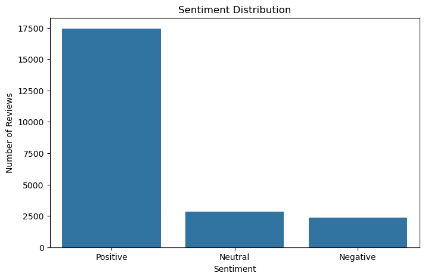
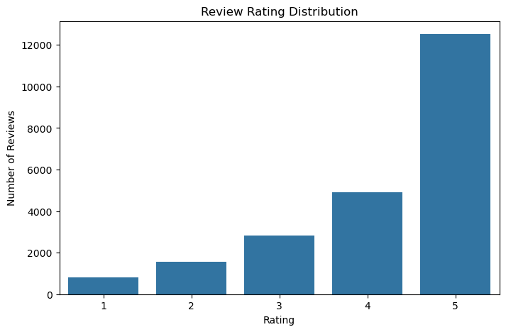
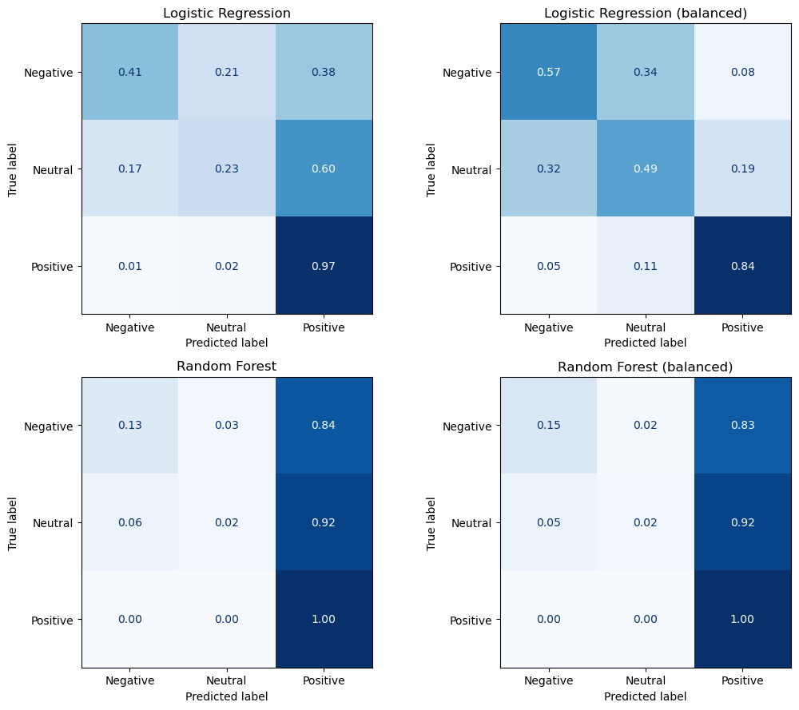
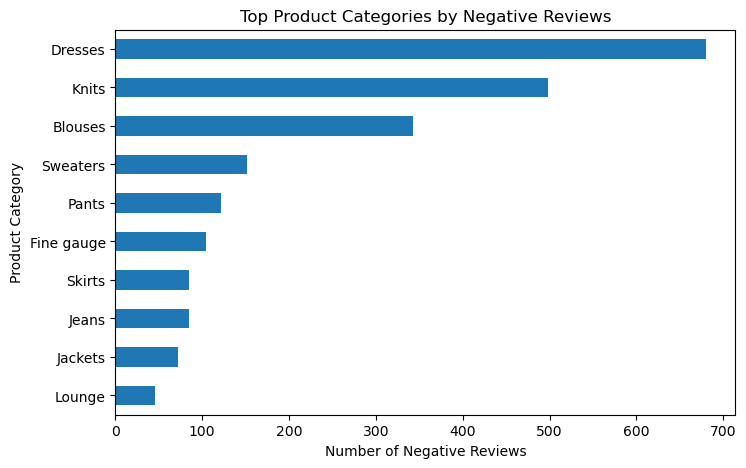

# 🧠 AI Customer Feedback Intelligence System

**Turning customer reviews into actionable business insights using Machine Learning and NLP.**

An end-to-end machine learning project that analyzes customer reviews, classifies sentiment, and discovers recurring complaint themes using K-Means clustering.

## 📌 Table of Contents

- [Overview](#-overview)
- [Problem and Solution](#-problem-and-solution)
- [Dataset](#-dataset)
- [Methodology](#️-methodology)
- [Model Evaluation](#-model-evaluation)
- [Customer Complaint Clustering](#-customer-complaint-clustering)
- [Key Business Insights](#-key-business-insights)
- [Project Structure](#️-project-structure)
- [Installation](#-installation)
- [Usage](#️-usage)
- [Saved Artifacts](#-saved-artifacts)
- [Limitations and Future Improvements](#️-limitations-and-future-improvements)
- [Documentation](#-documentation)
- [Author](#-author)

## 🎯 Overview

The **AI Customer Feedback Intelligence System** analyzes customer reviews from a women's e-commerce clothing dataset to understand customer sentiment and identify recurring product-related complaints.

The project combines supervised and unsupervised machine learning:

- **Sentiment Classification:** Logistic Regression and Random Forest classify reviews as Positive, Neutral, or Negative.
- **Complaint Clustering:** K-Means groups negative reviews into five complaint themes.
- **Exploratory Data Analysis:** Visualizations reveal sentiment distribution, common words, and product categories associated with negative feedback.

The goal is to transform unstructured customer feedback into insights that can support product quality analysis and customer experience improvement.

## ❓ Problem and Solution

### Problem

Manually reviewing thousands of customer comments is time-consuming and makes it difficult to identify recurring problems, monitor sentiment, and prioritize product improvements.

### Solution

This project implements a text analysis workflow that:

1. Cleans and preprocesses customer reviews.
2. Converts text into numerical features using TF-IDF (fitted on training data only).
3. Compares supervised classification models, with and without class weights.
4. Groups negative reviews into complaint themes using K-Means.
5. Summarizes findings to support data-driven business decisions.

## 📊 Dataset

**Dataset:** Women's E-Commerce Clothing Reviews (see [`data/README.md`](data/README.md) for how to obtain it).

| Metric                                       | Value  |
| -------------------------------------------- | ------ |
| Raw reviews                                  | 23,486 |
| Reviews after cleaning                       | 22,622 |
| Features retained before text transformation | 4      |
| TF-IDF features                              | 5,000  |
| Training samples                             | 18,097 |
| Test samples                                 | 4,525  |
| Negative reviews analyzed by K-Means         | 2,369  |

The selected columns include review text, rating, product category, and recommendation indicator.

### Sentiment Labeling

Sentiment labels are derived from star ratings:

- **Negative:** Rating ≤ 2
- **Neutral:** Rating = 3
- **Positive:** Rating ≥ 4

These are rating-derived labels rather than independently human-annotated sentiment labels.

### Data Preprocessing

- Removing rows with missing values and duplicate records.
- Renaming selected columns for clarity.
- Converting review text to lowercase.
- Tokenizing text with NLTK and keeping alphabetic tokens.
- Removing English stopwords.
- Creating a cleaned review text column.

## ⚙️ Methodology

### 1. Exploratory Data Analysis (EDA)

The notebook explores sentiment distribution, rating distribution, most frequent words, negative reviews by product category, and complaint cluster sizes.

| Sentiment distribution | Rating distribution |
| --- | --- |
|  |  |

### 2. Train/Test Split, then Feature Extraction

The data is split **first** (80/20, stratified, `random_state=42`). `TfidfVectorizer(max_features=5000)` is then fitted on the **training reviews only** and applied to the test reviews, so no test-set vocabulary or IDF information leaks into training.

### 3. Supervised Learning

Two classification algorithms are compared, each with and without `class_weight="balanced"`:

- Logistic Regression
- Random Forest Classifier

Evaluation uses accuracy, per-class recall, Macro F1-score, and confusion matrices, because the dataset is imbalanced (about 77% Positive).

### 4. Unsupervised Learning

K-Means is applied to the 2,369 negative reviews using five clusters. The top TF-IDF terms in each cluster are used to interpret the recurring complaint themes. A silhouette scan over k = 2–8 is included in the notebook as a sanity check.

## 📈 Model Evaluation

Results on the held-out test set (4,525 reviews). TF-IDF is fitted on the training split only.

| Metric          | Logistic Regression | Logistic Regression (balanced) | Random Forest | Random Forest (balanced) |
| --------------- | ------------------- | ------------------------------ | ------------- | ------------------------ |
| Accuracy        | 82.10%              | 77.04%                         | 78.32%        | 78.65%                   |
| Macro F1-score  | 0.57                | 0.60                           | 0.38          | 0.39                     |
| Negative Recall | 0.41                | 0.57                           | 0.13          | 0.15                     |
| Neutral Recall  | 0.23                | 0.49                           | 0.02          | 0.02                     |
| Positive Recall | 0.97                | 0.84                           | 1.00          | 1.00                     |



### Interpretation

Plain Logistic Regression has the highest accuracy, but it finds only 41% of Negative and 23% of Neutral reviews. Random Forest almost always predicts Positive, and class weights barely change that. Class weights help Logistic Regression: the balanced version has the best Macro F1 (0.60) and Negative recall (0.57), at the cost of accuracy. Neutral (3-star) reviews are mostly predicted as Positive. The models were compared on one fixed test split, and exact numbers can vary slightly across machines and library versions, so confirm the final choice with cross-validation.

## 🔎 Customer Complaint Clustering

K-Means divides the 2,369 negative reviews into five groups. The themes below are interpretations of the top terms in each cluster.

| Cluster | Reviews | Interpreted Theme            | Top terms                                              |
| ------- | ------- | ---------------------------- | ------------------------------------------------------ |
| 0       | 544     | Appearance mismatch          | like, looked, looks, look, back, fabric, cheap         |
| 1       | 191     | Boxy or short fit            | shirt, back, would, fabric, boxy, like, loved          |
| 2       | 428     | Dress-related disappointment | dress, like, would, fabric, back, disappointed         |
| 3       | 735     | Fabric and material quality  | quality, fabric, return, would, even, pants, thin      |
| 4       | 471     | Sizing issues                | top, small, size, ordered, would, fit, large           |

### Key Finding

Fabric and material quality (cluster 3) is the largest complaint group with 735 reviews (about 31% of the 2,369 negative reviews), followed by appearance mismatch (544) and sizing issues (471). The cluster names are interpretive labels, not manually verified ground-truth categories. Cluster numbers can change between runs.

**Caution:** silhouette scores for k = 2–8 are all very low (about 0.004–0.008; 0.0062 for k = 5), so the clusters overlap and should be treated as exploratory themes, not sharply separated groups.



## 💡 Key Business Insights

- **17,430 Positive reviews**
- **2,823 Neutral reviews**
- **2,369 Negative reviews**
- **4.18 average star rating**
- Dresses (680) and Knits (498) account for about half of all negative reviews.

Potential business applications include monitoring negative sentiment over time, identifying recurring quality and sizing complaints, prioritizing products for investigation, supporting customer service with automated sentiment tags, and tracking changes in complaint themes as new reviews arrive. These are potential applications, not results from a deployed production system.

## 🗂️ Project Structure

```
ai-customer-feedback-intelligence-system/
├── README.md
├── requirements.txt
├── .gitignore
├── LICENSE
├── notebooks/
│   └── ai_feedback_capstone.ipynb
├── src/
│   ├── preprocessing.py
│   ├── train.py
│   ├── evaluate.py
│   └── clustering.py
├── data/
│   └── README.md
├── models/
│   └── README.md
├── outputs/
│   └── figures/          # metrics, cluster summary and confusion matrices are written here
└── docs/
    ├── Project_Report.docx / .pdf
    ├── Presentation_Project.pptx / .pdf
    └── figures/
```

## 🚀 Installation

### Prerequisites

- Python 3.10 or newer
- pip

### 1. Clone the repository

```bash
git clone https://github.com/AhmedAbdullatifA/AI-Engineer-Journey.git
cd AI-Engineer-Journey/projects/ai-customer-feedback-intelligence-system
```

### 2. Create a virtual environment

```bash
python -m venv .venv
```

Windows: `.venv\Scripts\activate`  |  macOS / Linux: `source .venv/bin/activate`

### 3. Install dependencies

```bash
pip install -r requirements.txt
```

### 4. Prepare the dataset

Follow [`data/README.md`](data/README.md) and place the CSV at `data/Womens Clothing E-Commerce Reviews.csv`.

## ▶️ Usage

### Run the notebook

```bash
jupyter notebook notebooks/ai_feedback_capstone.ipynb
```

Run all cells in order (Kernel → Restart & Run All).

### Train from the command line

```bash
python -m src.train --data "data/Womens Clothing E-Commerce Reviews.csv"
```

This trains the four model variants, writes `outputs/model_metrics.csv`, `outputs/cluster_summary.csv`, confusion-matrix images in `outputs/figures/`, and saves `models/sentiment_pipeline.joblib`.

### Predict on new reviews

```python
import joblib
pipe = joblib.load("models/sentiment_pipeline.joblib")   # run from the repository root
pipe.predict(["The fabric feels cheap and the size runs very small."])
```

## 📦 Saved Artifacts

Generated locally and **not** committed to Git (see `.gitignore`):

- `models/sentiment_pipeline.joblib`: text cleaning + TF-IDF + classifier in one pipeline.
- `data/processed/cleaned_customer_reviews.csv`: cleaned review dataset (contains review text).
- `outputs/model_metrics.csv`, `outputs/cluster_summary.csv`, and `outputs/figures/*.png`.

Only load `.joblib` / `.pkl` files you created yourself or fully trust.

## ⚠️ Limitations and Future Improvements

- Sentiment labels are derived from star ratings, not manually annotated.
- Minority classes (Neutral and Negative) remain hard to detect; class weights help only partly and should be evaluated with cross-validation.
- The model variants are compared on one fixed test split; use cross-validation or a separate validation set for a final model choice.
- K-Means uses a pre-selected k = 5 and complaint themes are inferred from top terms, not verified manually.
- Cluster separation is weak (silhouette about 0.006); try other representations such as sentence embeddings.
- Add a Streamlit dashboard or API for interactive predictions.
- Evaluate on newer, independently labeled customer reviews.

## 📚 Documentation

The project report and presentation are in [`docs/`](docs/).

## 👨‍💻 Author

**Ahmed Abdullatif**

AI / Machine Learning Student, interested in Natural Language Processing, Machine Learning, and practical AI applications.

If you find this project useful, feel free to ⭐ the repository and share your feedback.
